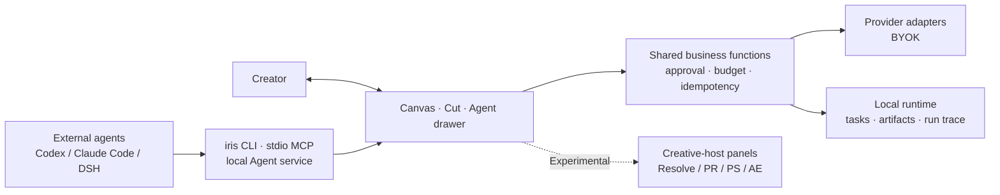

<h1 align="center">Iris</h1>

<p align="center">
  <strong>Iris — An infinite canvas for human and agent creation.</strong><br />
  <sub>An open-source AgentOS on an infinite canvas · 人与 Agent 共同创作的无限画布</sub><br />
  An agent-native creative production workspace: the Canvas organizes assets and generation, Cut edits the video timeline, and your agent helps you understand the project, review candidates and refine specific parts. Local-first, bring your own model keys (BYOK).
</p>

<p align="center">
  <strong>Think spatially. Create with anything. Stay in control.</strong><br />
  <sub>在空间中思考，以任何合适的方式创作，始终掌握作品的控制权</sub>
</p>

<p align="center">
  <sub>Formerly <strong>Flovart</strong> (renamed 2026-11-20). Live demo: <a href="https://iris.avabbbb.com">iris.avabbbb.com</a>.</sub>
</p>

<p align="center">
  English · <a href="./README.zh-CN.md">简体中文</a>
</p>

<p align="center">
  <a href="https://iris.avabbbb.com"><strong>Try live demo</strong></a> ·
  <a href="https://github.com/avabbbb/Iris/releases"><strong>Download preview</strong></a> ·
  <a href="docs/overview/quick-start.en.md">Get started</a> ·
  <a href="SUPPORT_MATRIX.md">Compatibility</a> ·
  <a href="docs/index.md">Docs (Chinese)</a>
</p>

<p align="center">
  
  
  
  
  <a href="https://github.com/avabbbb/Iris/releases"></a>
  <a href="https://github.com/avabbbb/Iris"></a>
</p>

<p align="center">
  <a href="stats/README.md"></a>
  <br />
  <sub>README views · third-party counter, not unique visitors</sub>
</p>

<p align="center">
  
  <br />
  <sub>Captured before the 2026-11-20 rename; the UI still shows the old name Flovart and the old name of the second tab.</sub>
</p>

## Watch the 90-second demo film

https://github.com/user-attachments/assets/2c77106e-8795-4308-82ce-51688d3ea259

<sub>720p inline · [1080p original](https://github.com/avabbbb/Iris/raw/refs/heads/main/pic/readme/vision/Iris_Promo_90s.mp4)</sub>

It starts from one sentence — "swap the cat's green-screen background for the scene in the reference image." The Agent drafts a generation plan, fills a missing frame, recovers from a failed call, asks when it is unsure and waits for your approval on the key step; then it edits, cuts to the beat, grades, scores, and saves the working flow as a Skill.

**This is an animated demo**, rebuilt from a real workflow. It shows the direction, not a list of verified capabilities — see the next two sections and the [Support Matrix](SUPPORT_MATRIX.md) for what exists today and what is planned.

## Foresight film: where Iris is heading (planned)

https://github.com/user-attachments/assets/9eadf0d3-ec36-4f40-8115-342c9891de40

<sub>720p inline · [1080p original](https://github.com/avabbbb/Iris/raw/refs/heads/main/pic/readme/vision/Iris_Foresight_100s.mp4)</sub>

The canvas-first direction in 100 seconds: the Agent lives on the canvas next to your work, past turns become cards, any reply can fork into a branch, heavy tasks open in the Agent Workbench, several agents work in parallel, and you comment directly on a time range of the result. **Everything in this film is planned, not shipped** — see [DESIGN.md](docs/design/DESIGN.md) for the design.

**Jump to:** [What works today](#what-works-today) · [Roadmap](#roadmap-planned) · [Quick start](#quick-start) · [Feature tour](#feature-tour) · [Architecture](#architecture) · [Compatibility](#compatibility) · [Local-first and security](#local-first-and-security) · [Contributing](#contributing)

## What works today

Three top-level tabs — **Canvas | Cut | Agent** — plus the built-in Agent chat drawer beside Canvas. Status labels follow the [Support Matrix](SUPPORT_MATRIX.md); unlabelled items are in the main branch but not separately certified.

**Canvas — infinite canvas and Workflow**
- Image, video, audio, text / note and script nodes; prompt directly on a node, `@`-mention connected references, pick a model per node.
- Node tools: crop, upscale, remove background, split layers, rotate, vectorize, split grid, outpaint, mask edit, filters; video trim / A-V split / merge / frame extraction; audio trim / speed / pitch / stem split; reverse prompt.
- Multi-result runs collapse into a primary node plus alternates; groups, auto-arrange, named snapshots, PNG / PDF export of a selection or the whole canvas; authorized local folders are read by reference, without copying bytes.
- Every mutation carries `projectId + expectedRevision + mutationId`, so humans and agents edit the same visible state.

**Cut — in-browser video editor**
- Multi-track timeline (video / image / audio / text), trim and move, subtitles, inspector, keyboard shortcuts, audio waveforms, preview proxies, font picker.
- Streaming WebCodecs decode and MP4 export ([Mediabunny](docs/adr/cut-editor.md)), written to an OPFS temp file; the result can go back onto the canvas (Canvas ↔ Cut link v1). Needs a Chromium-class browser with WebCodecs.
- "Storyboard · Reverse" sub-view: break a reference video into a shot table and turn it into a canvas sub-graph.

**Built-in Agent and tool surface**
- The Agent operates the canvas and Cut through `iris_*` tools that call the same business functions as the UI; canvas tool parameter schemas are discoverable (`workflow.node.tool.list`) and checked before anything is submitted.
- Approval tiers read / write / exec, with hard gates for spend and delete: paid generation shows a cost estimate and a generation plan card first, every delete is confirmed, and the session budget is reserved atomically before submit.
- Long jobs run as background tasks (`iris_task_start / get / cancel`); the task ledger survives reload and restart, and an unknown submit is queried instead of being re-charged.
- On-demand Skill loading (the system prompt carries only an index; `iris_skill_read` fetches the body), automatic context compaction, and per-project Agent memory.

**External agents**
- `iris` CLI + Agent Integration Skill (`skills/iris/`, projected into `.agents/` and `.claude/`). Stable surface: `status`, `workflow.inspect`, `workflow.selection.get`, `workflow.apply`, `workflow.node.run`. Codex CLI + Browser Workflow is **Beta**; Claude Code, OpenCode, WorkBuddy and stdio MCP (`tools/iris/mcp-server.js`) are **Experimental**.
- DeepSeek Harness plugin (`dsh-plugin/`): embeds the visible canvas in DSH and operates it through tools — **Experimental**.

**Generation, runtime and evaluation**
- BYOK: RunningHub image + video is the only provider path in certification (**Beta, pending certification**); OpenAI-compatible, Gemini, Seedance and others are **Experimental**.
- Desktop build (Tauri, Windows / macOS, 0.1.1 closed beta) with a local Rust runtime for durable tasks, artifacts and run traces.
- Agent video pipeline (`pipeline.run.*`, `composition.render`, `capture.ui`, …; Remotion rendering, trace stored locally): **Experimental**.
- Evaluation: rule checks, LLM-as-a-Judge, red-team and an AIGC item bank under `eval/` (overview in [eval/eval.md](eval/eval.md), Chinese).

## Roadmap (planned)

**None of this is implemented yet.** It follows [main design](docs/design/00-overview.md) §8, and each step has an evidence gate:

| Stage | What |
| --- | --- |
| P0 · Turn Context | Persist message ↔ asset references against real session / message IDs and record which media actually reached the model |
| P1 · Context Card | "Pin to canvas" turns an Agent conclusion into its own `plugin:context-card` node |
| P2 · Creative Proposal | Changes become reviewable proposals first — scope, diff, cost, approval, conflict detection; only the named segment changes |
| P3 · Resolve read | Read a DaVinci Resolve project and the selected clip through the official API / MCP, read-only |
| P4 · Resolve write | After approval, import into the Media Pool first, then verify a new track / timeline branch; never write the Resolve project database directly |
| P5 · Skill distillation | Distil reusable editing Skills from projects and runs the user authorizes; registered only after confirmation and a replay on new footage |

Also on the map, with no implementation commitment yet: native effects for AE / Premiere / Photoshop and Resolve OFX, Premiere and CapCut / 剪映 context connectors (剪映 6.0+ drafts are encrypted; Iris will not break that), and real screen-capture recording ([draft plan](docs/plans/recordly-capture-hub.md)).

## Quick start

**Just use it:** open [iris.avabbbb.com](https://iris.avabbbb.com), or download the Windows EXE / macOS DMG from [Releases](https://github.com/avabbbb/Iris/releases) (0.1.1 closed beta, unsigned: Windows shows a SmartScreen warning, macOS is ad-hoc signed and asks for confirmation). Add an AI service in Settings to generate; the canvas is editable without one.

**Run from source** (Node.js ≥ 22.19.0):

```bash
git clone https://github.com/avabbbb/Iris.git
cd Iris
npm install
npm run iris:cli -- start --source --web --open   # WebUI + local Agent, opens #/app
npm run iris:cli -- status --json                  # connection status
```

The web app is fully static: project data lives in your browser. The old Go backend was removed on 2026-11-17; the hosted Cloudflare Worker (`worker/index.ts`) only runs a stateless `/api/llm-proxy/*` forwarder. For the UI alone, `npm run dev` starts Vite on port 37522 (no Agent binding); `make up` runs the same Vite dev server in Docker at http://localhost:1635. More options: [Getting Started](docs/overview/quick-start.en.md).

**Let your coding agent drive:** after starting from source, ask Codex (or another agent) to "Open Iris and work on this Workflow." The Skill at `.agents/skills/iris/` teaches it the five stable operations; `ensure` and `doctor` handle setup and diagnostics. See the [Skill guide](docs/overview/skill-guide.md) (Chinese).

**Developer checks:** `npm test` (Vitest), `npx tsc --noEmit`, `npm run docs:check`, `npm run build`; for the desktop runtime, `cargo test --manifest-path src-tauri/Cargo.toml`.

**Closed-beta limitations:** paid generations bill on the provider side — stopping or reloading mid-generation may still be charged, so check your provider console before rerunning. Some generation error messages are Chinese-only. Please attach the crash-log export (Copy diagnostics on the error screen) to Beta feedback issues.

## Feature tour

<table width="100%">
  <tr>
    <td width="50%" valign="top"><br /><sub><b>Infinite canvas</b> — pan, zoom and drag nodes; connections follow.</sub></td>
    <td width="50%" valign="top"><br /><sub><b>Add any node</b> — double-click the canvas to create an image, video, note, script or audio-reference node.</sub></td>
  </tr>
  <tr>
    <td width="50%" valign="top"><br /><sub><b>Prompt on the node</b> — the composer @-mentions connected references; the node toolbar adds upscale, remove background and more.</sub></td>
    <td width="50%" valign="top"><br /><sub><b>Pick a model per node</b> — text-to-image and image-to-image models, configured with your own service.</sub></td>
  </tr>
  <tr>
    <td width="50%" valign="top"><br /><sub><b>Prompt library</b> — built-in edit recipes one click away from the composer.</sub></td>
    <td width="50%" valign="top"><br /><sub><b>Video nodes</b> — import clips, trim, split audio, and prompt a video model from the same canvas.</sub></td>
  </tr>
  <tr>
    <td width="50%" valign="top"><br /><sub><b>Layers, assets, local folders</b> — every node listed and reorderable beside the canvas.</sub></td>
    <td width="50%" valign="top"><br /><sub><b>Light and dark</b> — the same Workflow in the dark theme.</sub></td>
  </tr>
  <tr>
    <td width="50%" valign="top"><br /><sub><b>Agent beside the canvas</b> — add selected nodes to context and brief the assistant.</sub></td>
    <td width="50%" valign="top"><br /><sub><b>Production Skills</b> — pick a Skill from the hub before you ask.</sub></td>
  </tr>
  <tr>
    <td width="50%" valign="top"><br /><sub><b>Bring your coding agent</b> — connect DSH, Codex, Claude Code or your own agent through the Iris CLI.</sub></td>
    <td width="50%" valign="top"><br /><sub><b>Bring your own keys</b> — OpenAI-compatible, Gemini, Volcengine Seedance, RunningHub or a custom config.</sub></td>
  </tr>
</table>

<sub>Screenshots: the web build with a demo Workflow assembled from images already in this repository. No AI service is configured and nothing on the canvas was generated for these shots. Captured before the 2026-11-20 rename (the UI shows Flovart); there is no Cut screenshot yet.</sub>

## Architecture



- **One authority per state:** the visible Browser Workflow owns the canvas and `cutStore` owns the Cut project; CLI, MCP, DSH and host panels only translate parameters, permissions and results — they keep no second copy.
- **One generation path:** UI, Agent and CLI call the same task function and produce durable, checksummed artifacts; a late result never overwrites the version you selected.
- Code map: `components/workflow/` (canvas), `components/cut/` + `services/cut/` (Cut), `components/agent/` + `services/browserAgentKernel.ts` (built-in Agent), `tools/iris/` (CLI / MCP / pipeline), `agent/` (local Agent service), `src-tauri/` (desktop + Rust runtime), `integrations/studio/` (host panels). More in [AGENTS.md](AGENTS.md) and the [docs map](docs/index.md).

## Compatibility

| Path | Status |
| --- | --- |
| Codex CLI + Browser Workflow | Beta |
| RunningHub image + video | Beta (pending certification) |
| Claude Code / OpenCode / WorkBuddy / stdio MCP / DeepSeek Harness plugin | Experimental |
| OpenAI-compatible BYOK, Gemini, Seedance and other providers | Experimental |
| DaVinci Resolve Studio 21.1, Premiere Pro, Photoshop, After Effects panels | Experimental |
| Cut editor | Implemented (main branch + Vitest; needs WebCodecs) |
| Resolve read / write-back, native effects, Premiere / CapCut connectors | Planned |

`Experimental` and `Planned` are not Stable claims. Evidence and release gates live only in the [Support Matrix](SUPPORT_MATRIX.md); this table is not a second compatibility policy.

## Local-first and security

- Projects, assets and generation history are stored primarily in the browser (localforage / IndexedDB); cloud sync is not promised.
- API keys live in the encrypted local `localforage` vault and the frontend calls your configured model service directly. On the official WebUI, a few allowlisted gateways that reject browser CORS go through the same-origin Worker proxy; keys pass in transit and are neither stored nor logged. Treat the browser as part of the secret boundary.
- Agent and CLI paths receive redacted readiness and capability state, never raw credentials. Never put API keys in a prompt, log or repository.
- Official channels are only this repository, the [official WebUI](https://iris.avabbbb.com) (Cloudflare Worker `iris`) and desktop artifacts built by this repository's Actions.

Found a vulnerability? Report it privately through the [security policy](SECURITY.md).

## Contributing

Most useful areas: provider adapters, host integrations and Workflow capabilities. Open an [Issue](https://github.com/avabbbb/Iris/issues/new/choose), read the [contribution conventions](.github/CONTRIBUTING.md), and include verification screenshots with UI changes. Coding agents: read [AGENTS.md](AGENTS.md) first.

## Acknowledgements

Thanks to [@labiaaaaaaaaa](https://github.com/labiaaaaaaaaa) for driving third-party service compatibility and aggregation-endpoint fixes.

## License and disclaimer

Iris is licensed under the [MIT License](./LICENSE). By using the project, you agree to the [Terms of Service](./docs/TERMS_OF_SERVICE.md) and [Privacy Policy](./docs/PRIVACY_POLICY.md).

Iris does not bundle model services and makes no intellectual-property claim over generated content. You are responsible for the copyright, compliance and lawful use of your models, input assets and generated output. See [project data and statistics](stats/README.md).
