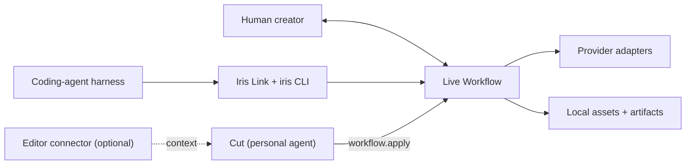

<h1 align="center">Iris</h1>

<p align="center">
  <sub>Formerly <strong>Flovart</strong> (renamed 2026-11-20). Live demo moved to <a href="https://iris.avabbbb.com">iris.avabbbb.com</a>.</sub>
</p>

<p align="center">
  <strong>Iris — open-source AgentOS on an infinite canvas.</strong><br />
  An open LibTV alternative where humans and coding agents edit the same live canvas; local-first, BYOK image/video models.
</p>

<p align="center">
  <strong>Your footage. Plus one layer.</strong>
</p>

<p align="center">
  Open-source, local-first Workflow + Agent creative tool. The DaVinci Resolve Studio 21.1 host layer is in development (Experimental).<br />
  Keep your edit in the host, let your Agent understand the context, and let Iris handle generation, references and durable candidates.
</p>

<p align="center">
  English · <a href="./README.zh-CN.md">简体中文</a>
</p>

<p align="center">
  <a href="https://iris.avabbbb.com"><strong>Try live demo</strong></a> ·
  <a href="https://github.com/avabbbb/Iris/releases"><strong>Download preview</strong></a> ·
  <a href="docs/overview/quick-start.en.md">Get started</a> ·
  <a href="SUPPORT_MATRIX.md">Compatibility</a>
</p>

<p align="center">
  
  
  
  
  <a href="https://github.com/avabbbb/Iris/releases"></a>
  <a href="https://github.com/avabbbb/Iris"></a>
</p>

<p align="center">
  <a href="stats/README.md"></a>
  <br />
  <sub>README views · third-party counter, not unique visitors</sub>
</p>


<p align="center">
  
</p>

## Watch the 60-second concept film

[](https://github.com/avabbbb/Iris/raw/refs/heads/main/pic/readme/vision/Iris_Promo_60s_v4.mp4)

**Keep the original. Describe the change. Compare candidates.** Iris brings your coding Agent and a visible creative Workflow together. Canvas handles generation and the visible Workflow, Agent connects your preferred assistant, and **Cut** (coming soon) is a personal post-production agent you talk to, with the canvas as its output.

The film shows the Resolve-first design target: point at a frame, generate creative layers, compare takes, and return an approved result. **Concept film.** The product was renamed from Flovart to Iris on 2026-11-20; the personal-agent tab is now called Cut (coming soon). Native host integration and alpha-layer/new-track output remain experimental or planned. Resolve P0 targets explicit **Add to Media Pool**.

**0.1.0 closed beta:** Windows EXE and macOS DMG builds are distributed through [Releases](https://github.com/avabbbb/Iris/releases). Platform builds are tested separately; installers do not certify creative-host or paid-provider support. See the [Support Matrix](SUPPORT_MATRIX.md).

## Product vision — the interaction we're building toward

This is the **north star for Iris product interaction and UI**. The product we are building should feel like this:

- **Cut works on its own; connecting your editor just adds context.** On the web, Cut is a conversation-first personal agent whose output lands on the Iris canvas — no editor required. Optionally connect a local host plugin (DaVinci Resolve first, then Premiere and CapCut / 剪映) so Cut picks up your timeline and selection without uploads. When you work inside the editor, Resolve stays the source of truth and Iris appears as a narrow contextual layer around the clip you are already on.
- **Draw where. Say what. Get a layer.** Point at the frame, describe the intent, then generate reviewable AI-layer candidates instead of replacing the source clip.
- **Candidates before commits.** Compare results visually, keep every version, and never let a late result silently replace the version you explicitly chose.
- **Human + Agent, one visible state.** Agent activity, revisions and out-of-date results are visible on the same Workflow that the creator can edit by hand.
- **Open the full Iris canvas only when the job needs it.** Multi-step references, stale branches, version history and more complex production expand into the visual Workflow instead of turning the host panel into a second app.
- **Return to the host non-destructively.** Approved results flow back through a reviewable handoff — Media Pool first, then a new layer/track only when that host capability is actually verified.
- **Local-first by default.** Footage, project context and durable results stay close to the creator's machine; external model calls are explicit and provider-scoped.

For implementation status and real-host gates, see the [Support Matrix](SUPPORT_MATRIX.md). Product/system details live in the [main design](docs/design/00-overview.md), [Agent Integration](docs/design/12-agent.md), [Interaction Design](docs/design/01-interaction.md), [Iris](docs/design/11-iris.md), and the [Resolve 21.1 Product & UI Spec](integrations/studio/resolve/PRODUCT_UI_SPEC.md).

**Jump to:** [Quick start](#quick-start) · [Why Iris?](#why-iris) · [Core capabilities](#core-capabilities) · [Feature tour](#feature-tour) · [Bring your own models](#bring-your-own-models) · [Compatibility](#integrations-and-compatibility) · [Architecture](#architecture) · [Local-first and security](#local-first-and-security) · [Roadmap](#creative-app-roadmap) · [Contributing](#contributing)

## Quick start

### For creators

1. Download a preview build from [GitHub Releases](https://github.com/avabbbb/Iris/releases).
2. Open Iris and add an AI service in Settings. For the Closed Beta, use RunningHub (image + video, Beta pending certification); other providers are Experimental.
3. Create or open a Workflow, add references, and start creating.

The Releases page may contain test or preview artifacts; it is not a claim that every host or provider is Stable.

### Known limitations (0.1.0 Closed Beta)

- Beta paths are Codex CLI + Browser Workflow (agent) and RunningHub image + video (provider, pending certification). Everything else, including DaVinci Resolve, WorkBuddy, Claude Code, OpenCode, Gemini and OpenAI-compatible BYOK, is Experimental.
- Builds are unsigned: Windows shows a SmartScreen warning (Authenticode is not configured) and macOS uses ad-hoc signing without notarization, so Gatekeeper asks for confirmation.
- Paid generations bill on the provider side. If you stop or reload during a generation, the provider may still charge; check your provider console before rerunning.
- Some generation error messages are still Chinese-only.
- Found a problem? Open a Beta feedback issue and attach the crash-log export (Copy diagnostics on the error screen).

### For coding-agent users

Run from a source checkout while the versioned CLI package remains a release gate:

```bash
git clone https://github.com/avabbbb/Iris.git
cd Iris
npm install
npm run iris:cli -- start --source --web --open
npm run iris:cli -- status --json
```

Then ask your local agent: **“Open Iris and work on this Workflow.”**

Your agent learns Iris through the **Agent Integration Skill** at `.agents/skills/iris/` (mirrored for Claude under `.claude/skills/iris/` and bundled for WorkBuddy under `integrations/workbuddy/iris/skills/iris/`). On a source checkout the harness auto-discovers it; the packaged CLI also ships it so `iris ensure` can register it. This is a thin adapter — it teaches the agent the 5 operations below; it is not a Production Skill / Marketplace feature.

The normal agent loop is `status`, `workflow.inspect`, `workflow.selection.get`, `workflow.apply` and `workflow.node.run`. Connection setup and diagnostics use `ensure` and `doctor`; development-only browser checks are covered in the [Getting Started guide](docs/overview/quick-start.en.md).

## Why Iris?

Most AI creative tools ask you to move your work into another canvas. **Iris goes the other way.**

Your professional editor remains the source of truth. Your Agent reads the creative context. Iris manages generation, references, durable artifacts and reviewable candidates — and the full Iris workspace opens only when the job actually needs a visual Workflow.

- **Inside the editor.** The first host path targets DaVinci Resolve Studio 21.1; other creative hosts remain Experimental until real-host validation.
- **Agent-native.** Agents act through typed Iris capabilities and host-native control surfaces instead of mouse coordinates or screen scraping.
- **Non-destructive by default.** Generated work starts as a candidate. The Resolve-first P0 ends at **Add to Media Pool** before timeline replacement is considered.
- **Bring your own models.** RunningHub image + video is the Beta provider path (pending certification); other providers and OpenAI-compatible BYOK are Experimental.
- **Local-first.** Project-adjacent state, references and generated artifacts stay close to the creative workspace wherever the current implementation supports it.

The canvas is still a power surface for multi-shot work, complex references and reusable workflows. **It is no longer the product premise.**

## Core capabilities

| Capability | Iris |
| --- | --- |
| Agent control | Typed operations against the actual visible Workflow |
| Human editing | The same graph, assets and results stay directly editable |
| Models | BYOK and multi-provider adapters, with capability-specific status |
| References | Graph connections, mentions, local assets and artifacts resolve into generation inputs |
| Automation | Explicit inspect/apply/run operations with revision and approval boundaries |
| Data | Local-first storage with documented browser and runtime boundaries |

Compose image, text, video, audio and configuration nodes, keep projects and references close to your workspace, and extend providers, hosts and node operations through explicit contracts. The top-level product surfaces are **Canvas** (the spatial Workflow), **Iris** (the personal post-production agent: conversation first, canvas as output, optional editor connectors; coming soon — the tab is a placeholder today), and **Agent** (the local/external coding-agent connection hub). Canvas + Agent are the Workflow production tools. The built-in **Assistant / Context / History** stays in a contextual drawer beside Canvas and is not duplicated inside Agent — see [Features](docs/content/docs/overview/features.en.mdx).

## Feature tour

<table width="100%">
  <tr>
    <td width="50%" valign="top"><br /><sub><b>Infinite canvas</b> — pan, zoom and drag nodes; connections follow.</sub></td>
    <td width="50%" valign="top"><br /><sub><b>Add any node</b> — double-click the canvas to create an image, video, note, script or audio-reference node.</sub></td>
  </tr>
  <tr>
    <td width="50%" valign="top"><br /><sub><b>Prompt on the node</b> — the composer @-mentions connected references; the node toolbar adds upscale, remove background and more.</sub></td>
    <td width="50%" valign="top"><br /><sub><b>Pick a model per node</b> — text-to-image and image-to-image models, configured with your own service.</sub></td>
  </tr>
  <tr>
    <td width="50%" valign="top"><br /><sub><b>Prompt library</b> — built-in edit recipes one click away from the composer.</sub></td>
    <td width="50%" valign="top"><br /><sub><b>Video nodes</b> — import clips, trim, split audio, and prompt a video model from the same canvas.</sub></td>
  </tr>
  <tr>
    <td width="50%" valign="top"><br /><sub><b>Layers, assets, local folders</b> — every node listed and reorderable beside the canvas.</sub></td>
    <td width="50%" valign="top"><br /><sub><b>Light and dark</b> — the same Workflow in the dark theme.</sub></td>
  </tr>
  <tr>
    <td width="50%" valign="top"><br /><sub><b>Agent beside the canvas</b> — add selected nodes to context and brief the assistant.</sub></td>
    <td width="50%" valign="top"><br /><sub><b>Production Skills</b> — pick a Skill from the hub before you ask.</sub></td>
  </tr>
  <tr>
    <td width="50%" valign="top"><br /><sub><b>Bring your coding agent</b> — connect DSH, Codex, Claude Code or your own agent through the Iris CLI.</sub></td>
    <td width="50%" valign="top"><br /><sub><b>Bring your own keys</b> — OpenAI-compatible, Gemini, Volcengine Seedance, RunningHub or a custom config.</sub></td>
  </tr>
</table>

<sub>Screenshots: the web build with a demo Workflow assembled from images already in this repository. No AI service is configured and nothing on the canvas was generated for these shots.</sub>

## One workflow, human + agent

```text
Your Agent                  Codex (Beta) · WorkBuddy, Claude Code (Experimental)
      │
      ▼
Iris Operations             inspect · select · apply · run
      │
      ▼
Live Workflow  ──────────── Human
      │
      └──────────────────── Models
```

With your agent, a brief becomes explicit operations: it reads the current project and revision, applies them, and can run a confirmed node. By hand, you add, move, resize and connect nodes, drop in local files, configure a model, run generation and iterate visually. Both paths converge on the same Workflow authority, so nothing the agent does is invisible to you.

## Bring your own models

```text
Your provider → your API key → your assets + Workflow → your generated result
```

Iris does not bundle model services. Configure a provider in the app, choose the capabilities and model you need, and keep the provider terms, cost and output rights in your own hands. OpenAI-compatible BYOK and remote-provider paths are Experimental: an adapter in the code is not a paid-provider certification. The Closed Beta certifies one paid provider path, RunningHub image + video, still Beta (pending certification) until certification completes.

## Integrations and compatibility

| Host or package | Status |
| --- | --- |
| Codex CLI + Browser Workflow | Beta |
| Claude Code CLI projection | Experimental |
| OpenCode CLI projection | Experimental |
| WorkBuddy CLI Connector | Experimental |
| CodeBuddy Code | Planned |
| Pi | Planned |
| Photoshop UXP panel | Experimental |
| Premiere Pro UXP panel | Experimental |
| After Effects | Experimental |
| DaVinci Resolve Studio | Experimental |
| Cut web personal agent | Planned (tab is a placeholder) |
| Cut editor connectors (Resolve → Premiere → CapCut / 剪映) | Planned; 剪映 6.0+ drafts are encrypted (to be verified) |

`Experimental`, `Planned` and External Gate items are not Stable claims. Evidence, boundaries and release gates live in the [Support Matrix](SUPPORT_MATRIX.md), which is the single source of truth; this table is not a second compatibility policy.

## Architecture



The existing `iris` CLI name is a compatibility surface during the Iris rebrand. CLI and the experimental stdio MCP share operation semantics and the current Browser Workflow binding. Deterministic operations do not require a second AI to reinterpret them.

Native-effect work keeps two short paths: one shared generation function produces durable media versions, and the host effect reads a fixed version and renders locally — no director/Operator/crew chain. Product scope and system boundaries live in the [main design](docs/design/00-overview.md); agent transport/authority details live in [Agent Integration](docs/design/12-agent.md). Historical target/current architecture reports no longer participate in product decisions.

## Local-first and security

- Projects, assets and generation history are stored primarily in the browser today; cloud sync is not promised.
- The current Web path stores API keys locally through the encrypted `localforage` vault, while the frontend calls the configured model service directly (on the official WebUI, a few allowlisted gateways that reject browser CORS go through the same-origin proxy of its Cloudflare Worker; keys pass in transit and are not stored or logged). Treat the browser as part of the secret boundary.
- Web, Desktop WebView and extension storage are normally isolated. Cross-entry synchronization through a restricted runtime bridge is still pending.
- Never put API keys in a prompt, log or repository. Agent and CLI paths receive redacted readiness and capability state, not raw credentials.
- Use only the repository, the [official WebUI](https://iris.avabbbb.com) (a Cloudflare Worker named `iris`) and desktop artifacts published by the repository's Actions as official project channels. Review each provider's terms and the rights for your inputs and outputs.

Found a vulnerability? Report it privately through the [security policy](SECURITY.md).

## Creative App Roadmap

The first creative-host direction is now **DaVinci Resolve Studio 21.1 first**.

The current product target is deliberately narrow:

```text
Current Resolve selection
→ Agent understands the task
→ Iris creates a durable candidate
→ review
→ Add to Media Pool
```

The original timeline remains unchanged in P0. Adding a candidate to a new track is a later gate; Replace / Commit comes only after target revalidation and recovery behavior are proven. Resolve OFX is deferred until a real workflow demonstrates the need for host-persisted effect parameters, keyframes or offline effect rendering.

After Effects, Premiere Pro and Photoshop work remains Experimental and is not used to claim certified host support.

The same host integrations double as optional **Cut context connectors**: read-only first, Resolve first, then Premiere (UXP) and CapCut / 剪映. 剪映 6.0+ drafts are encrypted and may not be readable from outside (to be verified); Iris will not break that encryption. See [Creative Hosts §7](docs/design/14-creative-hosts.md).

These are directions, not Stable support; follow [the roadmap](docs/content/docs/progress/todo.mdx), [pending verification](docs/content/docs/progress/pending-test.mdx) and the [Support Matrix](SUPPORT_MATRIX.md) for the evidence trail.

## Contributing

Contributions are especially useful in three areas: provider adapters, host integrations and Workflow capabilities. Open an [Issue](https://github.com/avabbbb/Iris/issues/new/choose), read the [contribution conventions](.github/CONTRIBUTING.md), and include verification evidence with UI changes.

## Acknowledgements

Thanks to [@labiaaaaaaaaa](https://github.com/labiaaaaaaaaa) for driving third-party service compatibility and aggregation-endpoint fixes.

## License and disclaimer

Iris is licensed under the [MIT License](./LICENSE). By using the project, you agree to the [Terms of Service](./docs/TERMS_OF_SERVICE.md) and [Privacy Policy](./docs/PRIVACY_POLICY.md).

Iris does not bundle model services and makes no intellectual-property claim over generated content. You are responsible for the copyright, compliance and lawful use of your models, input assets and generated output. See [project data and statistics](stats/README.md).