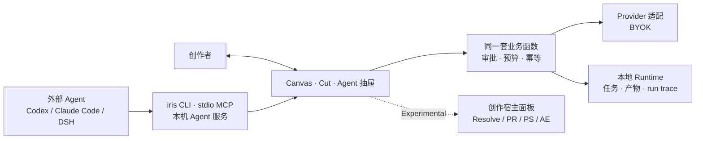

<h1 align="center">Iris</h1>

<p align="center">
  <strong>Iris —— 人与 Agent 共同创作的无限画布。</strong><br />
  <sub>开源的无限画布 AgentOS · 用户在哪里创作，Agent 就在哪里工作。</sub><br />
  Agent-native 创作生产工作台：Canvas 组织素材与生成流程，Cut 剪辑视频时间线，Agent 帮你理解工程、审查候选、精准返工；本地优先，模型自带密钥（BYOK）。
</p>

<p align="center">
  <strong>在空间中思考，以任何合适的方式创作，始终掌握作品的控制权。</strong>
</p>

<p align="center">
  <sub>原名 <strong>Flovart</strong>（2026-11-20 更名）。在线版：<a href="https://iris.avabbbb.com">iris.avabbbb.com</a>。</sub>
</p>

<p align="center">
  <a href="./README.md">English</a> · 简体中文
</p>

<p align="center">
  <a href="https://iris.avabbbb.com"><strong>在线体验</strong></a> ·
  <a href="https://github.com/avabbbb/Iris/releases"><strong>下载预览版</strong></a> ·
  <a href="docs/overview/quick-start.md">快速开始</a> ·
  <a href="SUPPORT_MATRIX.md">兼容性</a> ·
  <a href="docs/index.md">文档</a>
</p>

<p align="center">
  
  
  
  
  <a href="https://github.com/avabbbb/Iris/releases"></a>
  <a href="https://github.com/avabbbb/Iris"></a>
</p>

<p align="center">
  <a href="stats/README.md"></a>
  <br />
  <sub>README 展示次数 · 第三方计数，非独立访客</sub>
</p>

<p align="center">
  
  <br />
  <sub>截图摄于 2026-11-20 更名前，界面仍显示旧名 Flovart 和旧的第二个 tab 名。</sub>
</p>

## 先看 90 秒演示片

https://github.com/user-attachments/assets/2c77106e-8795-4308-82ce-51688d3ea259

<sub>页面内为 720p · [1080p 原片](https://github.com/avabbbb/Iris/raw/refs/heads/main/pic/readme/vision/Iris_Promo_90s.mp4)</sub>

一句话开场——「把小猫的绿幕背景，换成参考图里的场景」：Agent 先列生成计划，缺帧自己补、失败自己换路，拿不准先问你，关键一步等你批准；随后剪辑、卡点、调色、配乐，最后把跑通的流程存成 Skill。

**画面为演示动画**，按真实工作流重制，展示的是方向而不是逐项已验证的能力。哪些已经实现、哪些在规划中，见下面两节与 [Support Matrix](SUPPORT_MATRIX.md)。

## 前瞻片：Iris 接下来的方向（规划中）

https://github.com/user-attachments/assets/9eadf0d3-ec36-4f40-8115-342c9891de40

<sub>页面内为 720p · [1080p 原片](https://github.com/avabbbb/Iris/raw/refs/heads/main/pic/readme/vision/Iris_Foresight_100s.mp4)</sub>

100 秒讲清 Canvas-first：Agent 就在画布上、在作品旁边工作；历史对话变成卡片，任意一轮都能分叉成新分支；重任务一键展开到 Agent 工作台；多个 Agent 并行协作；直接在成片的某个时间段上留评论让它返工。**片中内容均为规划，尚未上线**，设计细节见 [DESIGN.md](docs/design/DESIGN.md)。

**跳转：** [已实现](#已实现) · [规划中](#规划中roadmap) · [快速开始](#快速开始) · [界面一览](#界面一览) · [架构](#架构) · [兼容性](#兼容性) · [本地优先与安全](#本地优先与安全) · [参与贡献](#参与贡献)

## 已实现

顶栏三个入口 **画布 Canvas｜Cut｜Agent**，加上 Canvas 右侧的内置 Agent 对话抽屉。状态标签以 [Support Matrix](SUPPORT_MATRIX.md) 为准；未标注的是主干代码里已有、但没有单独认证的能力。

**Canvas · 无限画布与 Workflow**
- 图片、视频、音频、文本 / 备注、脚本节点；节点上直接写提示词，`@` 引用连接的参考素材，每个节点单独选模型。
- 节点工具：裁剪、放大、去背景、拆图层、旋转、矢量化、宫格拆分、扩图、蒙版编辑、滤镜、视频裁切 / 音画分离 / 拼接 / 抽帧、音频裁切 / 变速 / 变调 / 分轨、反推提示词。
- 一次多张结果收成“首图节点 + 备选”；分组、自动整理、命名快照、选区或整张画布导出 PNG / PDF；授权本地文件夹按引用读取素材，不复制字节。
- 每次修改都带 `projectId + expectedRevision + mutationId`，人和 Agent 改的是同一份可见状态。

**Cut · 浏览器内视频剪辑器**
- 多轨时间线（视频 / 图片 / 音频 / 文字）、剪切移动、字幕、属性面板、快捷键、音频波形、预览代理、字体选择。
- 基于 WebCodecs（[Mediabunny](docs/adr/cut-editor.md)）流式解码与导出 MP4，导出写入 OPFS 临时文件；成片可回到画布（Canvas ↔ Cut 联动 v1）。需要 Chromium 系浏览器的 WebCodecs 支持。
- 子页「故事版 · 逆向」：参考视频拆解为镜头表，可转为画布子画布。

**内置 Agent 与工具面**
- Agent 通过 `iris_*` 工具操作画布与 Cut，与界面走同一批业务函数；画布工具的参数 schema 可查询（`workflow.node.tool.list`），提交前先做适用性与参数检查。
- 审批分 read / write / exec 三档，付费与删除是硬闸：付费生成先出费用预估与生成计划卡，删除每次确认；会话预算在提交前原子预留。
- 长任务后台执行（`iris_task_start / get / cancel`），任务台账在刷新或重启后恢复；提交状态未知时查询而不是重复扣费。
- Skill 按需加载（系统提示词只带索引，`iris_skill_read` 读全文）、上下文自动压缩、按项目保存的 Agent 记忆。

**外部 Agent**
- `iris` CLI + Agent Integration Skill（`skills/iris/`，投影到 `.agents/`、`.claude/`），稳定操作面：`status`、`workflow.inspect`、`workflow.selection.get`、`workflow.apply`、`workflow.node.run`。Codex CLI + Browser Workflow 为 **Beta**；Claude Code、OpenCode、WorkBuddy、stdio MCP（`tools/iris/mcp-server.js`）为 **Experimental**。
- DeepSeek Harness 插件（`dsh-plugin/`）：在 DSH 里嵌入可见画布并通过工具操作它，**Experimental**。

**生成、Runtime 与评测**
- BYOK：RunningHub 图片 + 视频是唯一进入认证流程的 Provider 路径（**Beta，待认证**）；OpenAI 兼容、Gemini、Seedance 等为 **Experimental**。
- 桌面版（Tauri，Windows / macOS，0.1.1 内测）带本机 Rust Runtime：持久任务、产物与 run trace。
- Agent 视频流水线（`pipeline.run.*`、`composition.render`、`capture.ui` 等，Remotion 渲染，trace 存本机）：**Experimental**。
- 评测：`eval/` 下的规则层、LLM-as-a-Judge、红队与 AIGC 题库（总纲 [eval/eval.md](eval/eval.md)）。

## 规划中（Roadmap）

以下**都还没有实现**，按 [00 总体设计](docs/design/00-overview.md) §8 的顺序推进，每一步都有必须观察到的证据门槛：

| 阶段 | 内容 |
| --- | --- |
| P0 · Turn Context | 消息与素材引用按真实会话 / 消息 ID 结构化持久化，记录实际送进模型的媒体 |
| P1 · Context Card | 把 Agent 的结论“钉到画布”，成为独立的 `plugin:context-card` 节点 |
| P2 · Creative Proposal | 修改先成为可审查的提案：范围、Diff、费用、审批、冲突检测，只改指定片段 |
| P3 · Resolve 读取 | 经官方 API / MCP 只读读取 DaVinci Resolve 工程与所选片段 |
| P4 · Resolve 写回 | 审批后先导入 Media Pool，再验证新轨道 / 新时间线分支；不直接写 Resolve 工程数据库 |
| P5 · Skill 蒸馏 | 从用户授权的已完成工程和成功 Run 提炼可复用的剪辑 Skill，经确认与回放验证后登记 |

另在路线上、尚无实现承诺的：AE / Premiere / Photoshop 原生效果与 Resolve OFX、Premiere 与 CapCut / 剪映 上下文连接器（剪映 6.0+ 草稿加密，不做破解）、真实操作录制（[计划草案](docs/plans/recordly-capture-hub.md)）。

## 快速开始

**直接用：** 打开 [iris.avabbbb.com](https://iris.avabbbb.com)，或从 [Releases](https://github.com/avabbbb/Iris/releases) 下载 Windows EXE / macOS DMG（0.1.1 内测，未签名：Windows 会有 SmartScreen 提示，macOS 为 ad-hoc 签名需手动确认）。在设置里添加 AI 服务后即可生成；不配服务也能编辑画布。

**从源码运行**（Node.js ≥ 22.19.0）：

```bash
git clone https://github.com/avabbbb/Iris.git
cd Iris
npm install
npm run iris:cli -- start --source --web --open   # 启动 WebUI + 本机 Agent，打开 #/app
npm run iris:cli -- status --json                  # 查看连接状态
```

网页版是全静态应用：项目数据存在浏览器本地；旧 Go 后端已于 2026-11-17 移除，线上的 Cloudflare Worker（`worker/index.ts`）只做无状态的 `/api/llm-proxy/*` 转发。只需要界面时可以 `npm run dev`（Vite，默认端口 37522，不带 Agent 绑定）；`make up` 用 Docker 起同一个 Vite 开发服务（http://localhost:1635）。其他方式见[快速开始](docs/overview/quick-start.md)与 [Windows 安装](docs/overview/installation.zh-CN.md)。

**让你的 Coding Agent 来操作：** 源码启动后，对 Codex 等 Agent 说「打开 Iris，处理这个 Workflow」。Agent 通过 `.agents/skills/iris/` 的 Skill 学会上面五个稳定操作；连接准备与诊断用 `ensure` 和 `doctor`。详见 [Skill 指南](docs/overview/skill-guide.md)。

**开发检查：** `npm test`（Vitest）、`npx tsc --noEmit`、`npm run docs:check`、`npm run build`；桌面 Runtime 另跑 `cargo test --manifest-path src-tauri/Cargo.toml`。

**内测已知限制：** 付费生成由 Provider 侧计费，生成中停止或刷新时 Provider 仍可能扣费，重跑前请先查控制台；部分生成错误信息只有中文；遇到问题请在 Beta 反馈 issue 里附上错误页「复制诊断信息」导出的日志。

## 界面一览

<table width="100%">
  <tr>
    <td width="50%" valign="top"><br /><sub><b>无限画布</b>——平移、缩放、拖动节点，连线自动跟随。</sub></td>
    <td width="50%" valign="top"><br /><sub><b>任意节点</b>——双击画布新建图片、视频、备注、脚本或音频参考节点。</sub></td>
  </tr>
  <tr>
    <td width="50%" valign="top"><br /><sub><b>节点上写提示词</b>——输入框可以 @ 连接的参考素材；节点工具条提供放大、去背景等。</sub></td>
    <td width="50%" valign="top"><br /><sub><b>每个节点选模型</b>——文生图、图生图模型，用你自己配置的服务。</sub></td>
  </tr>
  <tr>
    <td width="50%" valign="top"><br /><sub><b>提示词库</b>——内置编辑配方，从输入框一键调用。</sub></td>
    <td width="50%" valign="top"><br /><sub><b>视频节点</b>——导入片段、裁切、音画分离，并在同一张画布上调用视频模型。</sub></td>
  </tr>
  <tr>
    <td width="50%" valign="top"><br /><sub><b>图层、素材、本地文件夹</b>——每个节点都列在画布旁，可重新排序。</sub></td>
    <td width="50%" valign="top"><br /><sub><b>亮色与暗色</b>——同一份 Workflow 的暗色主题。</sub></td>
  </tr>
  <tr>
    <td width="50%" valign="top"><br /><sub><b>画布旁的 Agent</b>——把选中的节点加入上下文，再交代任务。</sub></td>
    <td width="50%" valign="top"><br /><sub><b>Production Skill</b>——提问前先从 Skill Hub 选一个 Skill。</sub></td>
  </tr>
  <tr>
    <td width="50%" valign="top"><br /><sub><b>接入你的 Coding Agent</b>——通过 Iris CLI 连接 DSH、Codex、Claude Code 或自己的 Agent。</sub></td>
    <td width="50%" valign="top"><br /><sub><b>自带密钥</b>——OpenAI 兼容、Gemini、火山 Seedance、RunningHub 或自定义配置。</sub></td>
  </tr>
</table>

<sub>截图来自网页版，示例 Workflow 由仓库里已有的图片拼成：没有配置 AI 服务，画布上的内容都不是为截图生成的。截图摄于 2026-11-20 更名前（界面显示 Flovart）；Cut 剪辑器暂无截图。</sub>

## 架构



- **单一权威**：可见的 Browser Workflow 是画布的权威，`cutStore` 是 Cut 工程的权威；CLI、MCP、DSH、宿主面板只做参数、权限与结果转换，不另存一份状态。
- **一条生成路径**：界面、Agent、CLI 调同一个任务函数，结果是带校验和的持久产物；晚到的结果不会覆盖你已选中的版本。
- 代码地图：`components/workflow/`（画布）、`components/cut/` + `services/cut/`（Cut）、`components/agent/` + `services/browserAgentKernel.ts`（内置 Agent）、`tools/iris/`（CLI / MCP / pipeline）、`agent/`（本机 Agent 服务）、`src-tauri/`（桌面与 Rust Runtime）、`integrations/studio/`（宿主面板）。更多见 [AGENTS.md](AGENTS.md) 与[文档地图](docs/index.md)。

## 兼容性

| 路径 | 状态 |
| --- | --- |
| Codex CLI + Browser Workflow | Beta |
| RunningHub 图片 + 视频 | Beta（待认证） |
| Claude Code / OpenCode / WorkBuddy / stdio MCP / DeepSeek Harness 插件 | Experimental |
| OpenAI 兼容 BYOK、Gemini、Seedance 等其他 Provider | Experimental |
| DaVinci Resolve Studio 21.1、Premiere Pro、Photoshop、After Effects 面板 | Experimental |
| Cut 剪辑器 | 已实现（主干代码 + Vitest；需 WebCodecs） |
| Resolve 读取 / 写回、原生效果、Premiere / CapCut 连接器 | Planned |

`Experimental` 和 `Planned` 都不是 Stable 承诺。证据与发布门禁以 [Support Matrix](SUPPORT_MATRIX.md) 为唯一依据，本表不是第二份兼容性口径。

## 本地优先与安全

- 项目、素材和生成记录目前主要保存在浏览器本地（localforage / IndexedDB）；不承诺云同步。
- API Key 存在本机加密的 `localforage` 密钥库，前端直接请求你配置的模型服务；官方在线版只有少数拒绝浏览器 CORS 的白名单网关经同源 Worker 转发，Key 只在传输中经过，不保存、不记录。请把浏览器视为密钥边界的一部分。
- Agent 与 CLI 只拿到脱敏后的就绪状态与能力，拿不到原始凭据；Key 不要写进提示词、日志或仓库。
- 官方渠道只有本仓库、[官方在线版](https://iris.avabbbb.com)（Cloudflare Worker `iris`）和本仓库 Actions 产出的桌面安装包。

发现漏洞请按[安全策略](SECURITY.md)私下报告。

## 参与贡献

最需要帮助的方向：Provider 适配、宿主集成、Workflow 能力。请先开 [Issue](https://github.com/avabbbb/Iris/issues/new/choose)，阅读[贡献约定](.github/CONTRIBUTING.md)；UI 改动请附验证截图。Coding Agent 请先读 [AGENTS.md](AGENTS.md)。

## 致谢

感谢 [@labiaaaaaaaaa](https://github.com/labiaaaaaaaaa) 推进第三方服务兼容与聚合端点修复。

## 许可与免责声明

Iris 使用 [MIT License](./LICENSE)。使用本项目即表示同意[服务条款](./docs/TERMS_OF_SERVICE.zh-CN.md)与[隐私政策](./docs/PRIVACY_POLICY.zh-CN.md)。

Iris 不内置模型服务，也不对生成内容主张知识产权。你需要对所用模型、输入素材与生成内容的版权、合规与合法使用负责。项目数据与统计见 [stats/README.md](stats/README.md)。
