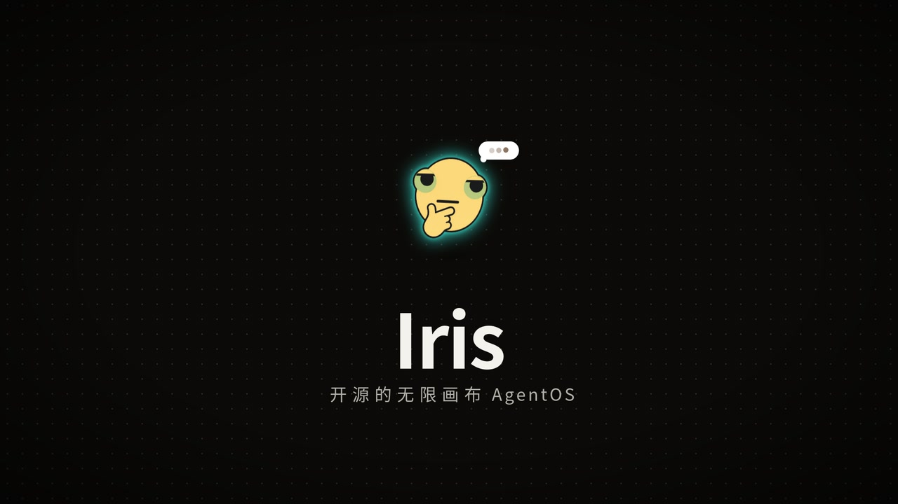
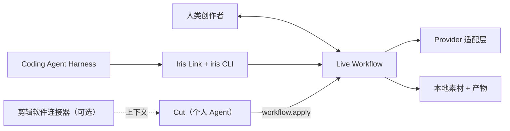

<h1 align="center">Iris</h1>

<p align="center">
  <sub>原名 <strong>Flovart</strong>（2026-11-20 更名）。在线版已迁到 <a href="https://iris.avabbbb.com">iris.avabbbb.com</a>。</sub>
</p>

<p align="center">
  <strong>Iris —— 开源的无限画布 AgentOS。</strong><br />
  开放的 LibTV 替代品：人和编程 Agent 在同一张实时画布上协作编辑；本地优先，图片 / 视频模型自带密钥（BYOK）。
</p>

<p align="center">
  <strong>保留你的原片，多一层创意。</strong>
</p>

<p align="center">
  开源、本地优先的 Workflow + Agent 创作工具；DaVinci Resolve Studio 21.1 宿主层开发中（Experimental）。<br />
  剪辑工程继续留在宿主里，Agent 理解上下文，Iris 负责生成、参考素材、持久产物与候选版本。
</p>

<p align="center">
  <a href="./README.md">English</a> · 简体中文
</p>

<p align="center">
  <a href="https://iris.avabbbb.com"><strong>在线体验</strong></a> ·
  <a href="https://github.com/avabbbb/Iris/releases"><strong>下载预览版</strong></a> ·
  <a href="docs/overview/quick-start.md">快速开始</a> ·
  <a href="SUPPORT_MATRIX.md">兼容性</a>
</p>

<p align="center">
  
  
  
  
  <a href="https://github.com/avabbbb/Iris/releases"></a>
  <a href="https://github.com/avabbbb/Iris"></a>
</p>

<p align="center">
  <a href="stats/README.md"></a>
  <br />
  <sub>README 展示次数 · 第三方计数，非独立访客</sub>
</p>


<p align="center">
  
</p>

## 先看 90 秒演示片

[](https://github.com/avabbbb/Iris/raw/refs/heads/main/pic/readme/vision/Iris_Promo_90s.mp4)

**保留原片，描述变化，比较候选。** Iris 把你自己的 Coding Agent 和可见创作 Workflow 放在一起：Canvas 做生成与可见 Workflow，Agent 连接你习惯的助手，**Cut**（即将推出）是可以直接对话的全能后期助手，产出落在画布上。

影片用一句话开场——「把小猫的绿幕背景，换成参考图里的场景」：Agent 先列生成计划，缺帧自己补、失败自己换路，拿不准先问你，关键一步等你批准；随后自动剪辑、卡点、调色、配乐，最后把跑通的流程存成 Skill。**画面为演示动画**，按真实工作流重制；产品已于 2026-11-20 由 Flovart 更名为 Iris。宿主集成、透明叠加层和新增轨道仍属 Experimental / Planned。Resolve P0 只以显式 **Add to Media Pool** 为安全输出。

**0.1.1 内测版：** Windows EXE 与 macOS DMG 通过 [Releases](https://github.com/avabbbb/Iris/releases) 分发。平台安装包分别验证，打包成功不等于宿主和付费 Provider 已认证；具体状态见 [Support Matrix](SUPPORT_MATRIX.md)。

## 产品愿景——我们要做的交互与 UI

这是 **Iris 产品交互、UI 和宿主协作方式的 North Star**，产品最终应该尽量接近这种感觉：

- **Cut 独立可用，连上剪辑软件只是多带上下文。** Web 版 Cut 是对话优先的个人 Agent，产出落在 Iris 画布上，不装剪辑软件也能用；可选连接本地宿主插件（DaVinci Resolve 先，Premiere、剪映 / CapCut 后续），自动带入时间线与选择，免手动上传。在剪辑软件里工作时，Resolve 继续是工程与时间线的权威，Iris 只围绕当前片段出现一个窄、轻、上下文明确的操作层。
- **Draw where. Say what. Get a layer.** 直接在画面上指出区域，再用自然语言说想要什么，得到可审核的 AI 叠加层候选，而不是先把原片替掉。
- **先候选，再提交。** 结果先比较；每个版本都保留；用户明确选中的版本不会被晚到结果偷偷覆盖。
- **人和 Agent 操作同一份可见状态。** Agent 在场、revision、哪些结果已经 stale，都能在同一个 Workflow 上看见，人也能继续手改。
- **只有复杂任务才展开完整 Iris。** 多步引用、过期分支、版本历史和复杂制作才进入 Canvas；宿主里的小面板不膨胀成第二个 Iris。
- **结果非破坏性回到宿主。** 先经过可审核的交接进入 Media Pool；只有真实验证过宿主能力后，才进一步上新图层 / 新轨道，而不是直接改原素材。
- **Local-first。** 素材、工程上下文和持久结果尽量留在本机；需要调用外部模型时明确告诉用户，并按 Provider 边界执行。

真实宿主与兼容状态以 [Support Matrix](SUPPORT_MATRIX.md) 为准。产品与系统边界见[主设计](docs/design/00-overview.md)、[Agent Integration](docs/design/12-agent.md)、[交互设计](docs/design/01-interaction.md)、[Iris](docs/design/11-iris.md) 和 [Resolve 21.1 Product & UI Spec](integrations/studio/resolve/PRODUCT_UI_SPEC.md)。

**快速跳转：** [快速开始](#快速开始) · [为什么是 Iris](#为什么是-iris) · [核心能力](#核心能力) · [功能一览](#功能一览) · [使用你自己的模型](#使用你自己的模型) · [集成与兼容性](#集成与兼容性) · [架构](#架构) · [本地优先与安全](#本地优先与安全) · [路线图](#创作软件路线图) · [参与贡献](#参与贡献)

## 快速开始

### 创作者

1. 从 [GitHub Releases](https://github.com/avabbbb/Iris/releases) 下载预览版。
2. 打开 Iris，在设置中添加 AI 服务。Closed Beta 请使用 RunningHub（图像 + 视频，Beta 待认证）；其他 Provider 为 Experimental。
3. 新建或打开 Workflow，加入参考素材，开始创作。

公开 Releases 页面可能包含测试或预览产物；这不代表所有宿主或 Provider 都已 Stable。

### 已知限制（0.1.1 内测版）

- Beta 路径只有 Codex CLI + Browser Workflow（Agent）与 RunningHub 图像 + 视频（Provider，待认证）。DaVinci Resolve、WorkBuddy、Claude Code、OpenCode、Gemini、OpenAI-compatible BYOK 等其余路径均为 Experimental。
- 安装包未签名：Windows 未配置 Authenticode，会出现 SmartScreen 提示；macOS 为 ad-hoc 签名且未公证，Gatekeeper 会要求确认。
- 付费生成由 Provider 侧计费。生成中停止或刷新页面后，Provider 仍可能扣费；重新运行前请先在 Provider 控制台确认。
- 部分生成错误提示目前只有中文。
- 遇到问题？请提交「内测反馈」 Issue，并附上崩溃日志导出（错误页上的「复制诊断」）。

### Coding Agent 用户

在版本化 CLI 包正式发布前，从源码检出运行：

```bash
git clone https://github.com/avabbbb/Iris.git
cd Iris
npm install
npm run iris:cli -- start --source --web --open
npm run iris:cli -- status --json
```

然后对本地 Agent 说：**「打开 Iris，在这个 Workflow 上干活。」**

正常 Agent 循环是 `status`、`workflow.inspect`、`workflow.selection.get`、`workflow.apply` 和 `workflow.node.run`；连接准备和诊断用 `ensure` 和 `doctor`；仅供开发使用的浏览器检查见[快速开始](docs/overview/quick-start.md)。

## 为什么是 Iris？

很多 AI 创作工具要求你先把工作搬到它自己的画布里。**Iris 反过来：进入你已经在用的专业创作软件。**

宿主继续掌握剪辑工程和时间线，外部 Agent 读取创作上下文，Iris 负责生成、参考素材、持久 Artifact 和可审核的候选版本；只有多镜头、复杂引用或可复用 Workflow 真正需要时，才展开完整 Iris 工作区。

- **留在编辑器里。** 第一宿主方向是 DaVinci Resolve Studio 21.1；其它创作宿主在真实宿主验证前继续保持 Experimental。
- **Agent-native。** Agent 通过类型化能力和宿主原生控制面工作，不依赖鼠标坐标或屏幕抓取。
- **默认非破坏。** 生成结果先成为 Candidate；Resolve-first 的 P0 只做到 **Add to Media Pool**，不会先替换原 Timeline。
- **自带模型。** Beta Provider 路径是 RunningHub 图像 + 视频（认证中）；其它 Provider 与 OpenAI-compatible BYOK 为 Experimental。
- **本地优先。** 在当前实现支持范围内，项目相关状态、参考素材与生成产物尽量留在创作工作区附近。

Canvas 仍然是多镜头、复杂依赖和 Workflow 编排的 power surface，**但它不再是 Iris 的产品前提。**

## 核心能力

| 能力 | Iris 的方式 |
| --- | --- |
| Agent 控制 | 通过类型化操作直接作用于真实可见 Workflow |
| 人类编辑 | 同一张图、素材和结果始终可以直接修改 |
| 模型 | BYOK 与多 Provider 适配，按具体能力标记状态 |
| 参考素材 | 图连接、提及、素材库和产物会解析成生成输入 |
| 自动化 | 显式的 inspect/apply/run 操作，带版本与审批边界 |
| 数据 | 本地优先，并明确浏览器与 Runtime 的边界 |

你可以把图片、文本、视频、音频和配置节点组合起来，让项目和参考素材留在自己的工作区，并通过明确契约扩展 Provider、宿主和节点操作。当前顶栏三个产品 surface 是：**Canvas** 负责空间化 Workflow，**Iris** 是全能后期助手（对话优先、画布为产出面、可选连接剪辑软件；即将推出，目前 tab 是占位），**Agent** 只负责本地/外部 Coding Agent 的连接、准备、状态与切换；内置 **Assistant / Context / History** 留在 Canvas 右侧 drawer，不在 Agent 页复制——详见[功能说明](docs/content/docs/overview/features.mdx)。

## 功能一览

<table width="100%">
  <tr>
    <td width="50%" valign="top"><br /><sub><b>无限画布</b>：平移、缩放、拖动节点，连线随之跟随。</sub></td>
    <td width="50%" valign="top"><br /><sub><b>添加任意节点</b>：双击画布即可新建图片、视频、备注、分镜脚本或音频参考节点。</sub></td>
  </tr>
  <tr>
    <td width="50%" valign="top"><br /><sub><b>在节点上写提示词</b>：输入框可 @ 引用已连接的参考图；节点工具栏提供放大、去背景等操作。</sub></td>
    <td width="50%" valign="top"><br /><sub><b>按节点选模型</b>：文生图、图生图模型，接入你自己的服务即可使用。</sub></td>
  </tr>
  <tr>
    <td width="50%" valign="top"><br /><sub><b>提示词库</b>：内置常用改图配方，在输入框一键调用。</sub></td>
    <td width="50%" valign="top"><br /><sub><b>视频节点</b>：导入片段、裁剪、分离音频，并在同一张画布上调用视频模型。</sub></td>
  </tr>
  <tr>
    <td width="50%" valign="top"><br /><sub><b>图层、资产与本地文件夹</b>：所有节点在画布旁列出，可拖动排序。</sub></td>
    <td width="50%" valign="top"><br /><sub><b>浅色与深色</b>：同一份 Workflow 的深色主题。</sub></td>
  </tr>
  <tr>
    <td width="50%" valign="top"><br /><sub><b>画布旁的 Agent</b>：把选中节点加入上下文，再向助手下达需求。</sub></td>
    <td width="50%" valign="top"><br /><sub><b>生产 Skill</b>：提问前先从 Skill Hub 选择 Skill。</sub></td>
  </tr>
  <tr>
    <td width="50%" valign="top"><br /><sub><b>接入你的 Coding Agent</b>：通过 Iris CLI 连接 DSH、Codex、Claude Code 或自建 Agent。</sub></td>
    <td width="50%" valign="top"><br /><sub><b>自带密钥（BYOK）</b>：OpenAI 兼容、Gemini、火山 Seedance、RunningHub 或自定义配置。</sub></td>
  </tr>
</table>

<sub>截图说明：Web 版界面，演示 Workflow 由本仓库已有图片搭建；截图时未配置任何 AI 服务，画布上的内容均非本次生成。</sub>

## 同一份 Workflow，人和 Agent 共用

```text
你的 Agent                  Codex（Beta）· WorkBuddy、Claude Code（Experimental）
      │
      ▼
Iris 操作                   inspect · select · apply · run
      │
      ▼
活着的 Workflow  ────────── 人
      │
      └──────────────────── 模型
```

用 Agent 时，一句 brief 会变成明确的操作：它读取当前项目和版本，应用这些操作，并可以运行一个已确认的节点。手工创作时，你照样可以添加、移动、调整大小和连接节点，拖入本地文件，配置模型，运行生成并继续迭代。两条路最终落在同一个 Workflow 权威状态上，所以 Agent 做的事你都能看见。

## 使用你自己的模型

```text
你的 Provider → 你的 API Key → 你的素材 + Workflow → 你的生成结果
```

Iris 不内置模型服务。你可以在应用中配置 Provider，按需选择能力和模型，并自行承担 Provider 条款、费用和产物权利。OpenAI-compatible BYOK 与远程 Provider 路径当前为 Experimental：代码里有适配器，不等于真实付费服务已认证。Closed Beta 只认证一条付费 Provider 路径：RunningHub 图像 + 视频，认证完成前状态为 Beta（待认证）。

## 集成与兼容性

| Host 或 package | 当前状态 |
| --- | --- |
| Codex CLI + Browser Workflow | Beta |
| Claude Code CLI projection | Experimental |
| OpenCode CLI projection | Experimental |
| WorkBuddy CLI Connector | Experimental |
| CodeBuddy Code | Planned |
| Pi | Planned |
| Photoshop UXP panel | Experimental |
| Premiere Pro UXP panel | Experimental |
| After Effects | Experimental |
| DaVinci Resolve Studio | Experimental |
| Cut Web 个人 Agent | Planned（tab 目前是占位） |
| Cut 剪辑软件连接器（Resolve → Premiere → 剪映 / CapCut） | Planned；剪映 6.0+ 草稿加密（待验证） |

`Experimental`、`Planned` 和 External Gate 都不是 Stable 能力。证据、边界与发布门槛统一记录在 [Support Matrix](SUPPORT_MATRIX.md)，那里是唯一的事实来源；这张表不是第二套兼容性政策。

## 架构



现有 `iris` CLI 名称在 Iris 改名期间继续作为兼容入口。CLI 与实验性 stdio MCP 共用操作语义，当前都绑定可见的 Browser Workflow。确定性操作直接执行，不需要第二个 AI 再解释一遍。

原生效果保持两条短路径：同一生成函数产出持久素材版本，宿主效果读取固定版本并本地渲染——不强制经过导演、Operator 或制作组层级。产品范围与系统边界统一见[主设计](docs/design/00-overview.md)，Agent transport/authority 见 [Agent Integration](docs/design/12-agent.md)；历史 CURRENT/TARGET 架构报告不再参与当前产品决策。

## 本地优先与安全

- 当前项目、素材和生成历史主要保存在浏览器本地，不承诺云同步。
- 当前 Web 路径通过加密的 `localforage` Vault 在本地保存 API Key，前端再直接请求配置的模型服务（官方 WebUI 上，少数不支持浏览器 CORS 的白名单网关经其 Cloudflare Worker 的同源代理转发，Key 只在传输中经过、不保存不记录）；浏览器属于秘密边界的一部分。
- Web、桌面 WebView 和扩展的存储通常彼此隔离；通过受限 Runtime Bridge 跨入口同步仍在待办中。
- 不要把 API Key 写进 Prompt、日志或仓库。Agent 和 CLI 只能拿到脱敏后的就绪与能力状态，不能拿到原始凭据。
- 官方项目渠道仅包括本仓库、[官方 WebUI](https://iris.avabbbb.com)（Cloudflare Worker `iris`）和本仓库 Actions 发布的桌面产物。请自行确认 Provider 条款，以及输入素材和输出内容的版权与合规性。

发现漏洞？请通过[安全政策](SECURITY.md)中的私密渠道报告。

## 创作软件路线图

当前第一宿主方向已经切换为 **DaVinci Resolve Studio 21.1 first**。

第一条产品闭环刻意保持很窄：

```text
当前 Resolve 选择
→ Agent 理解任务
→ Iris 生成持久 Candidate
→ 用户审核
→ Add to Media Pool
```

P0 不修改原 Timeline。Add to new track 是后续 gate；Replace / Commit 只有在目标重新校验与恢复语义跑通后才进入。Resolve OFX 也后置，只有真实工作流证明需要宿主持久参数、关键帧或离线 effect rendering 时才启动。

After Effects、Premiere Pro 与 Photoshop 现有工作继续保留为 Experimental，不用于宣称已认证宿主支持。

同一批宿主集成也是 **Cut 的可选上下文连接器**：只读起步，Resolve 先，Premiere（UXP）、剪映 / CapCut 后续。剪映 6.0+ 草稿加密，外部可能无法读取（待验证）；Iris 不做破解。见 [Creative Hosts §7](docs/design/14-creative-hosts.md)。

这些是方向，不是 Stable 支持。证据进度见[开发计划](docs/content/docs/progress/todo.mdx)、[待用户确认](docs/content/docs/progress/pending-test.mdx)和 [Support Matrix](SUPPORT_MATRIX.md)。

## 参与贡献

我们尤其欢迎三类贡献：Provider 适配、宿主集成和 Workflow 能力。请先提交 [Issue](https://github.com/avabbbb/Iris/issues/new/choose)，阅读[贡献约定](.github/CONTRIBUTING.md)，UI 变更附上验证证据。

## 致谢

感谢 [@labiaaaaaaaaa](https://github.com/labiaaaaaaaaa) 推进第三方服务适配与聚合端点修复。

## 协议与声明

Iris 基于 [MIT License](./LICENSE) 开源。使用本项目即表示同意[使用条款](./docs/TERMS_OF_SERVICE.md)和[隐私政策](./docs/PRIVACY_POLICY.md)。

Iris 不内置模型服务，也不对生成内容主张知识产权。你需要自行确认所选模型、输入素材和生成结果的版权、合规性与合法使用。更多信息见[项目数据与统计](stats/README.md)。